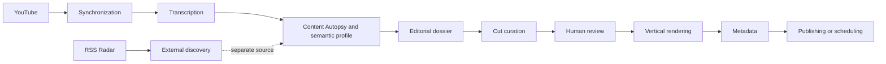

# Growth Engine

Local editorial intelligence and content production platform for YouTube channels.

Growth Engine turns channel history, metrics, transcripts, and external context into traceable editorial decisions: it identifies patterns, finds opportunities, selects moments for Shorts, renders vertical cuts, and prepares controlled distribution with human review and persistent state.

> Private technical portfolio project. The system is evolving, and some corporate capabilities are still being consolidated.

[Portuguese README](README.md) | [Corporate specification](docs/corporate_specification_growth_engine.en.md)

## Overview

The platform reduces the manual work between a published content library and new content production:

- synchronizes YouTube videos and metrics;
- transcribes long-form videos with local AI;
- performs Content Autopsy and builds a semantic channel profile;
- separates external Radar discovery from channel-evidence opportunities;
- creates editorial dossiers and cut candidates;
- validates titles and descriptions against the actual interval text;
- renders vertical Shorts with FFmpeg;
- supports review, publishing, and scheduling;
- persists jobs, checkpoints, notifications, failures, and history.

## Product flow

## Main modules

| Module | Responsibility |
|---|---|
| `core/web_server.py` | HTTP API, routes, and Operations Center orchestration |
| `core/database.py` | SQLite schema, connections, and migrations |
| `core/transcriber.py` | Whisper, DirectCompute, SRT, JSON, and caching |
| `core/autopsia.py` | Forensic video analysis and evidence |
| `core/content_profile.py` | Semantic channel profile |
| `core/editorial_mapper.py` | Editorial dossier, chapters, and moment map |
| `core/cutter.py` | Cut curation, validation, and metadata |
| `core/media_tools.py` | FFmpeg, crop, blur, encoders, and MP4 validation |
| `core/publisher.py` | Publishing, scheduling, and metadata |
| `core/radar_sources.py` | RSS providers and Radar sources |
| `frontend/app.js` | SPA, review workflows, polling, and Operations Center actions |

## Technology stack

- **Backend:** Python, `ThreadingHTTPServer`, `requests`, and SQLite with WAL.
- **Frontend:** HTML5, CSS3, and JavaScript without a mandatory framework.
- **Local AI:** Ollama with Qwen `qwen2.5:14b`.
- **Transcription:** DirectCompute/Whisper for AMD and `faster-whisper`/CTranslate2.
- **Media:** FFmpeg, FFprobe, OpenCV, AMD AMF, and `libx264` fallback.
- **Download:** `yt-dlp`, with Node.js support for JavaScript challenges.
- **Automation:** Playwright for selected YouTube Studio workflows.
- **Security:** Fernet tokens, CSP, Origin allowlist, URL validation, and DOM-safe rendering.
- **Native panel:** CustomTkinter, psutil, pystray, Pillow, and PyInstaller.
- **Testing:** `unittest`, mocks, and frontend, AI, media, OAuth, and persistence contracts.

## Architecture and technical decisions

- Local AI reduces the need to send transcripts to external services.
- Caches and fingerprints avoid expensive reprocessing when evidence has not changed.
- Persistent jobs provide checkpoints, limited retries, cancellation, and resume.
- Channel evidence and external Radar discovery remain separate sources.
- MP4 output is physically validated before it is considered ready for publishing.
- AMD encoder fallback to CPU is available when required.
- Operational state is persisted in the database and kept separate from the reference editorial dossier.

## Current status

### Core available

Channel analysis, transcription, semantic profiling, Radar, editorial dossiers, cut curation, vertical rendering, human review, metadata, real-media operation, and idempotent publishing and scheduling.

The renderer also provides MediaPipe intelligent facial framing, shot classification, and Active Speaker Tracking. Wide shots or very small faces use an intentional vertical fallback composition. Styled captions per cut can be configured, previewed, and rendered into the MP4.

### Being consolidated

- complete structural tenant isolation;
- corporate RBAC and auditing;
- provider metrics and health checks;
- progressive backend and frontend modularization.

## Local execution

### Requirements

- Windows;
- Python 3 and the project's virtual environment;
- FFmpeg and FFprobe available on `PATH` or configured explicitly;
- Node.js for auxiliary `yt-dlp` flows;
- local Ollama when Qwen analysis is enabled;
- YouTube OAuth credentials configured outside version control.

### Startup

1. Create or activate the Python virtual environment.
2. Install the project dependencies in the same interpreter.
3. Configure credentials through `configurar_segredos.py`.
4. Run `iniciar_growth_engine.bat` or `python iniciar_servidor.py`.
5. Open the port configured by the local server.

The project uses Git-ignored local files for credentials, databases, media, caches, Chrome profiles, models, and runtime artifacts. See [AI documentation](documentacao_ia.md) and [modular architecture](docs/arquitetura_modular.md) before setting up another machine.

## Quality and security

Tests cover domain contracts, invalid AI responses, the Ollama watchdog, cut timestamps, rendering, OAuth, persistence, idempotent publishing, captions, XSS, and profile isolation. Real-media operation and publishing to the channel have been exercised; production care still includes backups, migrations, health checks, and concurrency/recovery scenarios that are not fully covered yet.

Credentials, tokens, databases, media, caches, and browser profiles must never be committed. The `.gitignore` contains the standard exclusions for this material.

## Documentation

- [Portuguese corporate specification](docs/especificacao_corporativa_growth_engine.md)
- [English corporate specification](docs/corporate_specification_growth_engine.en.md)
- [Modular architecture](docs/arquitetura_modular.md)
- [AI documentation](documentacao_ia.md)
- [Project backlog](BACKLOG.md)
- [Implementation history](historico_implementacoes.md)

## License and use

This is a private portfolio project. The code, workflows, and artifacts must not be redistributed or used outside the context authorized by the repository owner.
