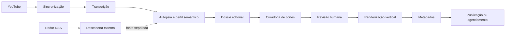

# Growth Engine

[English README](README.en.md)

Plataforma local de inteligência editorial e produção de conteúdo para canais do YouTube.

O Growth Engine transforma histórico do canal, métricas, transcrições e contexto externo em decisões editoriais rastreáveis: identifica padrões, encontra oportunidades, seleciona momentos para Shorts, renderiza cortes verticais e prepara a distribuição com revisão humana e estados persistentes.

> Projeto privado de portfólio técnico. O sistema está em evolução e algumas capacidades corporativas permanecem em consolidação.

## Visão geral

A plataforma reduz o trabalho manual entre o acervo publicado e a produção de novos conteúdos:

- sincroniza vídeos e métricas do YouTube;
- transcreve vídeos longos com IA local;
- realiza Autópsia de conteúdo e constrói perfil semântico;
- separa Radar externo de oportunidades baseadas na evidência do canal;
- cria dossiês editoriais e candidatos a cortes;
- valida títulos e descrições contra o texto real do intervalo;
- renderiza Shorts verticais com FFmpeg;
- permite revisão, publicação e agendamento;
- persiste jobs, checkpoints, notificações, falhas e histórico.

## Fluxo do produto

## Principais módulos

| Módulo | Responsabilidade |
|---|---|
| `core/web_server.py` | API HTTP, rotas e orquestração da Central |
| `core/database.py` | SQLite, schema, conexões e migrações |
| `core/transcriber.py` | Whisper, DirectCompute, SRT, JSON e cache |
| `core/autopsia.py` | Análise forense de vídeos e evidências |
| `core/content_profile.py` | Perfil semântico do canal |
| `core/editorial_mapper.py` | Dossiê editorial, capítulos e mapa de momentos |
| `core/cutter.py` | Curadoria, validação e metadados dos cortes |
| `core/media_tools.py` | FFmpeg, crop, blur, encoders e validação de MP4 |
| `core/publisher.py` | Publicação, agendamento e metadados |
| `core/radar_sources.py` | Providers RSS e fontes do Radar |
| `frontend/app.js` | SPA, revisão, polling e operações da Central |

## Stack tecnológica

- **Backend:** Python, `ThreadingHTTPServer`, `requests` e SQLite com WAL.
- **Frontend:** HTML5, CSS3 e JavaScript sem framework obrigatório.
- **IA local:** Ollama com Qwen `qwen2.5:14b`.
- **Transcrição:** DirectCompute/Whisper para AMD e `faster-whisper`/CTranslate2.
- **Mídia:** FFmpeg, FFprobe, OpenCV, AMD AMF e fallback `libx264`.
- **Download:** `yt-dlp`, com Node.js auxiliar para desafios JavaScript.
- **Automação:** Playwright para fluxos específicos do YouTube Studio.
- **Segurança:** Fernet para tokens, CSP, allowlist de Origin, validação de URLs e renderização DOM-safe.
- **Painel nativo:** CustomTkinter, psutil, pystray, Pillow e PyInstaller.
- **Testes:** `unittest`, mocks e contratos de frontend, IA, mídia, OAuth e persistência.

## Arquitetura e decisões

- IA executada localmente para reduzir o envio de transcrições a serviços externos.
- Cache e fingerprints para evitar reprocessamento pesado sem mudança de evidência.
- Jobs persistentes com checkpoints, retry limitado, cancelamento e retomada.
- Separação entre evidência editorial do canal e descoberta externa do Radar.
- MP4 validado fisicamente antes de ser considerado pronto para publicação.
- Fallback de encoder AMD para CPU quando necessário.
- Estado operacional persistido no banco, separado do dossiê editorial de referência.

## Estado atual

### Disponível no núcleo

Análise de canal, transcrição, perfil semântico, Radar, dossiê editorial, curadoria de cortes, renderização vertical, revisão manual, metadados, operação com mídia real e publicação e agendamento idempotentes.

O renderizador também oferece enquadramento facial inteligente com MediaPipe, classificação de planos e Active Speaker Tracking. Planos amplos ou rostos pequenos usam composição vertical de fallback. Legendas estilizadas por corte podem ser configuradas, pré-visualizadas e renderizadas no MP4. A arquitetura já é modular por domínios, com repositories, providers e executor de tarefas, e o isolamento por perfil/canal cobre dados, mídia, jobs e rotas.

### Em consolidação

- isolamento multi-tenant completo, além do isolamento por perfil/canal já existente;
- RBAC e auditoria corporativa;
- métricas e health checks de providers;
- extração completa dos handlers HTTP e dos clientes/renderizadores do frontend, pois a modularização por domínios já está em uso.

## Execução local

### Pré-requisitos

- Windows;
- Python 3 e ambiente virtual do projeto;
- FFmpeg e FFprobe disponíveis no `PATH` ou configurados;
- Node.js para os fluxos auxiliares do `yt-dlp`;
- Ollama local, quando forem usadas análises por Qwen;
- credenciais OAuth do YouTube configuradas fora do controle de versão.

### Inicialização

1. Crie ou ative o ambiente virtual Python.
2. Instale as dependências do projeto no mesmo interpretador.
3. Configure as credenciais pelo fluxo local de `configurar_segredos.py`.
4. Execute `iniciar_growth_engine.bat` ou `python iniciar_servidor.py`.
5. Acesse a porta configurada pelo servidor local.

O projeto utiliza arquivos locais ignorados pelo Git para credenciais, bancos, mídia, caches, perfil Chrome, modelos e artefatos de execução. Consulte [documentacao_ia.md](documentacao_ia.md) e [docs/arquitetura_modular.md](docs/arquitetura_modular.md) antes de configurar uma nova máquina.

## Qualidade e segurança

Os testes cobrem contratos de domínio, respostas inválidas da IA, watchdog do Ollama, timestamps de cortes, renderização, OAuth, persistência, publicação idempotente, legendas, XSS e isolamento por perfil. A operação com mídia real e publicação no canal já foi exercitada; permanecem como cuidados de produção backup, migrações, health checks e cenários de concorrência/recuperação ainda não cobertos integralmente.

Nenhuma credencial, token, banco de dados, mídia, cache ou perfil de navegador deve ser commitado. O `.gitignore` contém as exclusões padrão para esse material.

## Documentação

- [Especificação corporativa](docs/especificacao_corporativa_growth_engine.md)
- [Corporate specification - English](docs/corporate_specification_growth_engine.en.md)
- [Arquitetura modular](docs/arquitetura_modular.md)
- [Documentação de IA](documentacao_ia.md)
- [Backlog do projeto](BACKLOG.md)
- [Histórico de implementações](historico_implementacoes.md)

## Licença e uso

Este é um projeto privado de portfólio. O código, os fluxos e os artefatos não devem ser redistribuídos ou utilizados fora do contexto autorizado pelo proprietário do repositório.
